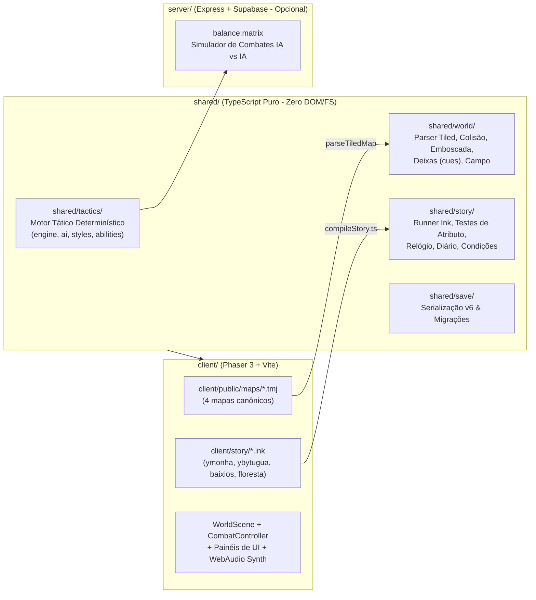

# Análise Geral, Crítica de Roteiro, Fichas de Personagens e Potencial de Hooks — *Três na Estrada* (ex-*Eälen*)

> **Documento de Diagnóstico Completo do Projeto**
> **Data:** 26 de outubro de 2026
> **Escopo:** Arquitetura técnica (`shared/`, `client/`, `server/`), análise literária e ludonarrativa do roteiro em Ink (`client/story/*.ink`), dossiê completo de personagens e bestiário, e avaliação mercadológica de *hooks* (clipes, Shorts/TikTok/Reels e retenção de streamers).

---

## Sumário Executivo (A Verdade Nua e Crua)

**O que você tem nas mãos hoje é um motor tático 2D extraordinariamente bem engenheirado, casado com uma direção literária madura, seca e rara em RPGs — mas que atualmente sofre de uma compressão extrema de roteiro e de uma carência visual que esconde suas melhores ideias.**

Se formos 100% honestos:
1. **A escrita frase a frase é excelente.** O tom lembra literatura brasileira seca (Graciliano Ramos encontrando fantasia sombria *low-magic* ao estilo *The Witcher* / *Black Company*). Não há exposição artificial, ninguém fala como anime ou Marvel, e as regras do mundo aparecem no calo da mão dos personagens.
2. **O roteiro atual é um esqueleto curto demais para sustentar o peso dramático que propõe.** Os quatro arquivos de história (`ymonha.ink`, `ybytugua.ink`, `baixios.ink`, `floresta.ink`) somam **618 linhas no total**, sendo apenas **~220 linhas efetivas de diálogo e narração**. A promessa de um jogo de *"2 a 4 horas"* não se sustenta no texto atual: a história inteira pode ser lida em 8 minutos.
3. **O clímax dramático do Ato 3 (a morte de Oryndu) tem um problema grave de dissonância ludonarrativa.** O jogo ensina paciência ao jogador e a Endyru no Ato 2, mas no Ato 3 tira o controle do jogador numa *cue* obrigatória (`round 3`) para forçar Endyru a agir com pressa e matar Oryndu.
4. **O jogo é uma mina de ouro de *hooks* mecânicos e narrativos para clipes**, porque quase todas as mecânicas subvertem clichês de RPG (a companheira que se recusa a dar o primeiro golpe por voto, a cura que drena o fôlego e dá fome em quem é curado, o ferreiro demônio que pede unha do pé na têmpera, o chefe anfíbio que você não vence batendo, mas puxando da água metro a metro). Contudo, para virar clipe viral, essas sacadas precisam de *feedback* visual e sonoro que hoje ainda está em estado de *placeholder*.

Abaixo está o detalhamento completo de cada um desses pontos.

---

## Parte 1: Crítica Honesta e Profunda do Roteiro

### 1.1. O que o roteiro faz brilhantemente (Não mexa nisso)

#### A. Economia verbal e recusa ao melodrama
A maior virtude do texto é o que ele **não** diz. Os diálogos são curtos, concretos e ancorados em trabalho, dinheiro, água e ferro:
- *"Mercador: Era um de prata na lua passada. / Guarda do pedágio: Era."*
- *"Conselheira: Um grupo de rio acima, de três espadas. Entraram na água de manhã. / Endyru: E? / Conselheira: E o contrato continua no quadro."*
- *"Acham Oryndu de manhã, rio abaixo, preso no remo. Ninguém diz nada a Endyru."*

Não há discursos épicos, não há vilão gargalhando, não há choro teatral. Quando Oryndu morre, o pagamento dele (a *"parte de quem fica"*, que Jarupã exigiu escrever na margem do contrato lá no Ato 1!) vira uma cena muda na guilda dos barqueiros:
> *"Na guilda dos barqueiros, cada um dos três conta duas moedas em cima da mesa do mestre. Ninguém diz pra quem são. / Mestre da guilda: Eu sei pra quem é."*

Esse *setup / payoff* entre a exigência cínica de Jarupã no Ato 1 (*"E a parte de quem fica? ... Então escreve"*) e o pagamento silencioso no final é **roteiro de altíssimo nível**.

#### B. O segredo de Xanduí contado exclusivamente pela forma
A regra de ouro do `AGENTS.md` (§1.1 e §3.3) — Xanduí é analfabeta e ninguém no jogo jamais diz isso em voz alta — foi executada com precisão cirúrgica nos quatro momentos em que aparece:
1. Na Mesa dos Contratos (`ybytugua.ink`), ela diz que *"a letra dela não serve pra conselho"* e empurra o papel para Endyru: *"Lê alto, estudante. Você lê bonito."*
2. No quadro de avisos (`quadro`), ela arranca o aviso do prego, *"segura um tempo, de cabeça pra baixo, e passa pra Endyru: Lê aí. Você lê bonito."*
3. No pátio do Castelão (`ymonha.ink`), quando o Castelão diz que o contrato não fala de castelo, Xanduí recita de cor, palavra por palavra, a frase exata que ouviu Endyru ler no Ato 1: *"O contratado responde pelo bicho dos baixios, e pelo que lhe der causa, até a cheia baixar."*
4. No final (`fim`), Endyru lhe entrega uma cópia escrita do relatório. Ela dobra duas vezes, guarda na camisa e mente com naturalidade: *"Vou ler com calma."* E quando Jarupã pede *"Lê pra mim depois"*, ela fecha com *"Leio."*

Isso respeita a inteligência do jogador. Quem prestar atenção vai sentir um frio na barriga de empatia na última cena.

#### C. O final político anti-fantasia (Realpolitik fluvial)
Em 99% dos RPGs, matar o monstro salva a cidade e derrota o plano do senhor feudal. Aqui, o trio mata o Ykuruã, entrega a prova de que Ymboripe sabotou o rio... e uma semana depois **Ybytuguá assina a rendição a Ymboripe mesmo assim**:
> *"Endyru: Vocês leram o livro do castelão. / Conselheira: Lemos. E lemos o que a próxima cheia faz com uma cidade sem senhor."*

É um soco no estômago realista: três aventureiros matam um bicho no lodo, mas não param a macroeconomia e a unificação política de uma região. Isso dá ao mundo a sensação imediata de ser maior que os protagonistas.

---

### 1.2. Os Problemas Reais do Roteiro (Onde está falhando hoje)

Se você quer que este jogo seja memorável e dure de 2 a 4 horas, aqui estão os pontos onde o roteiro atual tropeça:

#### Problema 1: A Morte de Oryndu e a "Pressa Forçada" no Ato 3 (`baixios.ink`)
Este é o maior problema estrutural do roteiro hoje. Vamos olhar a sequência de eventos:
1. **Ato 1 (`abertura` e `primeira_ida`):** Endyru é apressado. Quer conjurar no rio, entra na água antes da hora, quase morre. Oryndu salva o grupo. Faz todo sentido.
2. **Ato 2 (`margem`):** Endyru senta na areia ao lado de Oryndu. Tenta ficar parado, pega um galho, risca um círculo letra por letra. A água apaga, ele recomeça mais acima. Passa a tarde inteira até fechar o círculo sem erro ao pôr do sol. **Ele aprende a lição na prática e sobe para o Círculo (`mage_rise(4)`).**
3. **Ato 3 (`a_cheia` e `final_pressa`):** Antes da luta, Oryndu diz *"Vocês puxam. Devagar."* Endyru concorda: *"Devagar."* O jogador pode inclusive escolher descansar e gravar os círculos na margem, jogando exatamente como o jogo ensinou.
4. **A falha na Rodada 3:** Na rodada 3 da luta final, não importa se o jogador está controlando perfeitamente a mana, puxando o Ykuruã devagar com Versos e vencendo com calma. A deixa `final_pressa` dispara obrigatoriamente (`when: round 3`, `burst: hero`, `dismiss: party:oryndu`):
   > *"Três rodadas puxando um bicho do tamanho de um barco, um verso de cada vez, e ele ainda tem metade do corpo na água. Endyru abre o livro na página inteira e lê alto, de uma vez, tudo, rápido, pra acabar com isso."*

**Por que isso é ruim como está?**
- **Contradição de arco:** Endyru acabou de passar pelo momento de iluminação dele no Ato 2 (`margem`), onde aprendeu a paciência do Círculo. Regredir na cena imediatamente seguinte faz a cena da praia parecer inútil.
- **Frustração do jogador (Culpa postiça):** Em um jogo tático onde o jogador controla a mana de Endyru turno a turno, tirar o controle dele para fazê-lo cometer um erro estúpido que o próprio jogador estava evitando cria revolta contra o roteirista (*"Eu não fiz isso, foi a cutscene!"*), em vez de culpa genuína.

**Como consertar sem mudar o cânone (Oryndu ainda morre pela pressa de Endyru):**
- **Conserto Narrativo (dar um motivo urgente para a pressa na Rodada 3):** Endyru não deve abrir o livro na Rodada 3 porque *"ficou entediado/impaciente depois de 18 segundos de luta"*. Ele deve ter pressa porque **algo deu errado na margem** (ex.: o Ykuruã dá um bote em Jarupã/Xanduí, ou a cheia sobe de repente ameaçando arrastar o círculo de areia, e Endyru, achando que já é um mago de Círculo capaz de segurar o tranco, tenta resolver de uma vez para salvar a luta). A arrogância de quem acabou de subir ao Círculo (*"Agora eu aguento uma página inteira!"*) é muito mais convincente do que pura birra infantil.
- **Conserto Mecânico (Opcional, mas genial):** Em vez de disparar num `round 3` seco, e se na Rodada 3 o jogo der um turno para Endyru onde a única habilidade disponível (ou uma tentação clara diante de uma crise) seja o encantamento grande, ou a deixa mostrar que a água subiu e está apagando os círculos gravados, forçando o improviso apressado?

#### Problema 2: O Ato 2 na Floresta (`floresta.ink`) é um corredor vazio de 58 linhas
Olhe para `floresta.ink`. Ele inteiro tem 3 cenas:
1. Chegada na floresta (4 linhas de diálogo).
2. `leitura_na_margem`: Você acha o Recitador lendo para o rio. Grita ou ataca. Mata ele. Acha um papel no bolso que diz literalmente tudo: *"Ler na cheia, nos baixios abaixo de Ybytuguá e na margem rio acima, de três em três noites, até a cidade pedir senhor. Pagamento com o castelão da corrente. [Selo de Ymboripe]"*.
3. `contratados_caem`: Uma luta com aventureiros contratados que têm 4 linhas depois de cair (*"Assinei escolta... Leram pra mim"*).

**Por que isso é fraco hoje?**
- **Zero investigação:** O jogador não junta nenhuma peça. O recitador carrega no bolso uma confissão assinada e carimbada que explica o plano geopolítico inteiro de Ymboripe. Por que um estudante pago por baixo dos panos para sabotar uma cidade livre andaria no mato com um documento selado dizendo *"Acorde o monstro até a cidade pedir senhor"*?
- **Como melhorar mantendo a simplicidade:** O papel do recitador deveria ser uma **ordem técnica seca e um recibo**, não um resumo de vilão de desenho animado. Exemplo: uma página copiada de repulsão de alto impacto, marcada com os dias da lua e os pontos do rio, e uma ordem de pagamento contra o livro do castelão da corrente. Quem junta *"Eles estão lendo repulsão na água a cada três noites"* + *"Oryndu: O bicho não acordou, acordaram ele"* + *"Castelão paga com prata de Ymboripe"* são os personagens e o jogador!
- **A cena dos aventureiros contratados (`contratados_caem`) começa pelo fim:** Hoje eles só falam *depois* de apanhar (`onDefeat`). Mas eles são o **espelho sombrio de Jarupã e Xanduí**: espadachins analfabetos que assinaram um contrato numa Mesa sem saber o que estavam escoltando! Se houver um diálogo de 6 linhas *antes* da luta (ou durante), onde Jarupã e Xanduí percebem que poderiam ser eles ali do outro lado se Endyru não soubesse ler o contrato, a temática do jogo dobra de peso.

#### Problema 3: Falta de convivência e "estrada" num jogo chamado *Três na Estrada*
O título provisório é *Três na Estrada*, e a premissa central é mostrar como Endyru, Jarupã e Xanduí formaram o grupo lendário que vemos aposentado 25 anos depois no Livro 1.
Porém, hoje:
- Eles trocam meia dúzia de frases na corrente (`abertura`).
- Assinam o contrato na Mesa (`trio`).
- Têm a cena ótima da bota no ferreiro (`ferreiro`).
- E depois quase só falam frases funcionais de 4 palavras sobre o objetivo da missão!

**Onde está a amizade nascendo?** Onde está Jarupã implicando com o livro de Endyru? Onde está Xanduí perguntando pra que Endyru quer tanto voltar pra universidade? Onde está Endyru descobrindo por que Jarupã (Gryskar, bate primeiro) e Xanduí (Ipojy, nunca bate primeiro) andam juntos se as escolas deles são opostas?
- **Sugestão prática:** Use o sistema de descanso (`R`) ou gatilhos curtos de travessia para colocar **3 ou 4 conversas curtas de fogueira/barco (10-12 linhas cada)**. Em especial, a dinâmica entre um cara do Gryskar e uma mulher da Ipojy que dividem a mesma escolta (*"Ele começa pra eu poder entrar"* / *"Ela espera pra consertar a besteira que eu fiz"*) já existe na abertura, mas merece mais 2 ou 3 momentos de respiro no Ato 2.

#### Problema 4: A Matemática da Bolsa de Moedas (Um detalhe quebrado ou fácil de travar)
Vamos conferir a matemática do dinheiro no roteiro atual:
- Na `abertura`, Endyru recebe **9 de cobre** (`~ earn("cobre", 9)`).
  - Se pagar a cabeça, gasta **3 de cobre** (sobram 6 de cobre).
  - Para que servem os outros 6 (ou 9) de cobre no resto do jogo? **Para absolutamente nada!** O Escrivão menciona *"eu leio o quadro por uma moeda"*, mas não há opção de pagar cobre a ninguém em Ybytuguá, nem de comprar Pão de Viagem ou Unguento com cobre. As moedas de cobre ficam mortas na bolsa até os créditos!
- Na `conselheira`, ao assinar o contrato, o grupo recebe **2 de prata** de adiantamento (`~ earn("prata", 2)`).
  - No `ferreiro`, temperar as duas espadas custa **2 de prata** (`~ pay("prata", 2)`).
  - Isso é redondo, **mas**: e se o jogador for para o Ato 3 sem falar com o ferreiro e ficar com os 2 de prata no bolso? No final (`fim`), o texto diz: *"A conselheira paga o relatório em cima da mesa comprida. Dezoito moedas de prata, em três pilhas de seis. `~ earn("prata", 6)` ... Na guilda dos barqueiros, cada um dos três conta duas moedas em cima da mesa do mestre. `{pay("prata", 2): Mestre da guilda: Eu sei pra quem é.}`"*. Tudo certo ali, mas os **6 ou 9 de cobre** da abertura nunca tiveram uso nenhum no jogo! Dar ao jogador uma banquinha no cais onde 6 de cobre compram um Pão de Viagem ou um Unguento de Barqueiro (ou pagar um barqueiro/informante) faria aquela economia inicial da abertura (*"contando nove moedas de cobre pela terceira vez"*) valer de verdade.

---

## Parte 2: Dossiê Completo de Personagens e Bestiário

Abaixo estão todas as descrições consolidadas (Lore do cânone + Psicologia + Ficha Mecânica no código `shared/`).

### 2.1. O Grupo Principal

#### 1. Endyru (Protagonista)
- **Quem é no cânone:** Humano. Jovem estudante da Universidade de Xerumbetyba (em Kuatiarape) que ficou sem dinheiro para terminar os estudos e desceu o rio Ymonhã atrás de contratos. 25 anos depois, no Livro 1 da série, será o pai de Karuã e professor titular da cátedra de Atração e Repulsão em Itamoguá.
- **Personalidade e Arco:** Culto, alfabetizado, observador, mas **apressado e orgulhoso**. Quer o dinheiro, a subida de nível e o nome agora. Acredita que o conhecimento acadêmico substitui o tempo da estrada. O arco dele no jogo é descobrir que a pressa na magia mata quem está ao redor — a origem exata do trauma que o fará passar a vida alertando o filho Karuã de que a estrada mata.
- **Ficha Mecânica (`shared/party.ts` & `shared/characterCreation.ts`):**
  - **Classe / Conceito:** `atracao_repulsao` (Mago de Atração e Repulsão) — Papel: **Controle e Preparo**.
  - **Nível de Mago:** Começa em **Página (Nível 3)** (Limite de 3 de mana por turno sem sangrar) e sobe no Ato 2 para **Círculo (Nível 4)** (Limite de 4 de mana por turno).
  - **Atributos Base (Nível 1):** Força `3`, Fator `8`, Vigor `5` (HP inicial: `40`), Olho `5`, Couro `4`, Lábia `6`, Saber `8`.
  - **Equipamento Inicial:** *Bordão* (`1d6`, alcance 1, madeira sem texto) e *Túnica de Linho* (Defesa +1).
  - **Repertório de Habilidades (`shared/tactics/abilities.ts`):**
    - *Puxão* (Ação Bônus, 1 Mana, Recitada, Alcance 4): Puxa o alvo 2 quadrados na direção de Endyru.
    - *Bordão* (Ação, 0 Mana, Imediata, Alcance 1): Golpe físico fraco (`1d6 + Fator/Saber`), única coisa que não precisa recitar.
    - *Empurrão* (Ação, 2 Mana, Recitada, Alcance 3): Dano (`1d6`) + empurra o alvo 2 quadrados para trás.
    - *Guarda* (Ação, 0 Mana, Imediata): Postura defensiva e recupera +1 Fôlego.
    - *Cura* (Ação, 2 Mana, Recitada, Alcance 4): Primeiros socorros (`1d6 + Fator`), cobrando Fôlego e dando Fome ao paciente.
    - *Desarmar* (Técnica de Círculo — `mage: 4`, Ação, 3 Mana, Recitada, Alcance 4): Aplica condição *Desarmado* por 2 turnos.
    - *Arremesso* (Técnica de Círculo — `mage: 4`, Ação, 4 Mana, Recitada, Alcance 4): Dano pesado (`1d8 x 1.5`) + empurra 3 quadrados. Consome o limite inteiro de um turno de Círculo.
  - **Fraqueza Mecânica:** Nos níveis baixos, espadachins amassam magos. Suas magias são **Recitadas** (declaradas num turno, saem no início do próximo; se apanhar no meio, precisa passar num teste de `d20 + Saber >= 10 + metade do dano` para não perder a conjuração). Para lançar na hora ou abrir emboscada, precisa **Gravar** círculos durante o descanso (`R`). Se gastar mais mana num turno do que seu nível de mago, sofre a marca **Sangue e tremor** (`bloodied`: -2 de acerto até descansar) e atrai o Ykuruã.

#### 2. Jarupã (Companheiro — Linha de Frente Ofensiva)
- **Quem é no cânone:** Humano. Espadachim de aluguel, parceiro de estrada de Xanduí (trabalham juntos escoltando barcos no Ymonhã). 25 anos depois, será marido de Xanduí, pai de Exandy e professor em Itamoguá.
- **Personalidade:** Canastrão, pragmático, zero erudição (não sabe ler, e ao contrário de Xanduí não tem vergonha nenhuma disso: *"A minha também não. Nunca serviu pra nada"*). Apesar do jeito fanfarrão de quem quer resolver tudo na lâmina (*"Deixa comigo"*), conhece as leis não-escritas da estrada: é ele quem exige que Endyru escreva no contrato *"a parte de quem fica"* (a pensão para a família de quem morrer na missão) e quem tira a bota sem pestanejar na oficina do ferreiro demônio.
- **Ficha Mecânica:**
  - **Classe:** `espadachim` — Papel: **Agressor / Pressão Contínua**.
  - **Escola de Espada:** **Gryskar** (*o Bate-Primeiro*), Grau II.
  - **Nível de Aura:** **Fio** (Nível 2).
  - **Traço da Escola (A Onda — `momentum`):** Cada golpe de alvo único que acerta o **mesmo inimigo** consecutivamente soma `+1` de dano cumulativo (até `+4`). Se errar ou trocar de alvo, a Onda zera. Vence a escola *Tsvirana* (`+2` no ataque) e perde para a *Ipojy* (`-2` no ataque).
  - **Atributos Base (Nível 1):** Força `8`, Fator `2`, Vigor `7` (HP inicial: `48`), Olho `7`, Couro `6`, Lábia `4`, Saber `3`.
  - **Equipamento:** Começa com *Espada Pesada* de ferro-cru (`1d10`, alcance 1, `-1` acerto) e *Gibão de Couro* (Defesa +2). No ferreiro, sobe para *Espada Pesada Temperada* (`1d12`, alcance 1, sem penalidade de acerto).
  - **Repertório:** *Golpe Rápido* (Ação Bônus, `+3` acerto, `0.6x` dano), *Golpe* (Ação, `1x` dano, ataque de oportunidade), *Golpe Pesado* (Ação, `-4` acerto, `1.8x` dano + metade da Força, custa 2 Fôlego, 1 turno de recarga) e *Guarda* (+1 Fôlego).

#### 3. Xanduí (Companheira — Linha de Frente Defensiva / Contra-Ataque)
- **Quem é no cânone:** Humana. Espadachim da escola *Ipojy* (*a Espera*), parceira de Jarupã. Futura mãe e mestra de Exandy.
- **Personalidade e Segredo:** Canastrona, seca, econômica nas palavras e com uma memória auditiva absurda. **Não sabe ler**, mas esconde isso com orgulho feroz atrás de desculpas sutis (*"a minha letra não serve pra conselho"*, *"lê aí, você lê bonito"*). É por causa do analfabetismo dela e de Jarupã que ela puxa Endyru para o contrato e forma o trio. Segue o voto religioso/marcial da Ipojy ao pé da letra: **nunca dá o primeiro golpe**. Ela e Jarupã funcionam como engrenagens complementares: como ela não pode abrir uma briga, Jarupã sempre abre por ela (*"Xanduí: Eu não começo. / Jarupã: Eu sei. Por isso eu começo."*).
- **Ficha Mecânica:**
  - **Classe:** `espadachim` — Papel: **Duelista de Reação / Parede**.
  - **Escola de Espada:** **Ipojy** (*a Espera*), Grau II.
  - **Nível de Aura:** **Fio** (Nível 2).
  - **O Voto (`vow: true`) e o Traço (Contragolpe — `counter: true`):**
    - **Restrição Real no Motor:** Enquanto ninguém na luta tiver dado o primeiro golpe hostil (`!encounter.opened`), Xanduí **não tem alvos válidos para nenhum ataque** e não dá ataques de oportunidade. Mesmo depois da luta aberta, ela não pode atacar inimigos que ainda estejam *Surpresos*, e fora de luta não pode iniciar emboscadas (`F`).
    - **Recompensa Mecânica:** Qualquer inimigo que ataque Xanduí e **erre** (erro normal ou falha crítica) ativa imediatamente o **Contragolpe** dela como reação, levando um golpe de volta na mesma hora. Além disso, a Ipojy tem vantagem de `+2` de acerto contra *Gryskar* (e `-2` contra *Tsvirana*).
  - **Atributos Base (Nível 1):** Força `8`, Fator `2`, Vigor `7` (HP inicial: `48`), Olho `7`, Couro `6`, Lábia `4`, Saber `3`.
  - **Equipamento:** Começa com *Espada Reta* de ferro-cru (`1d8`, alcance 1) e *Gibão de Couro* (Defesa +2). No ferreiro, sobe para *Espada Reta Temperada* (`1d10`, `+1` acerto).

#### 4. Oryndu (Companheiro de Apoio — Barqueiro)
- **Quem é no cânone:** Humano, barqueiro veterano do rio Ymonhã. Conhece a cheia, os baixios e as leis não-escritas da água.
- **Personalidade e Papel Temático:** É a encarnação viva do tema do jogo (*respeitar o tempo*). Fala pouco, age devagar, bate o remo no casco três vezes e espera o rio responder. Senta uma tarde inteira olhando a água sem dizer uma palavra até que Endyru aprenda a riscar o círculo devagar. Morre afogado no Ato 3 quando o Ykuruã, atraído pelo estouro de mana de Endyru, vira o barco com que ele segurava a margem para o grupo.
- **Mecânica de Apoio (`shared/tactics/supports.ts`):**
  - Não ocupa quadrado na grade, não tem barra de vida e não pode ser atacado.
  - Oferece o apoio **Ler a água (`read_water`)**: Uma vez por rodada, qualquer membro do grupo pode acionar Oryndu gratuitamente (sem gastar ação nem ação bônus) mirando um inimigo. O motor roda o planejador determinístico da IA (`foresee` em `ai.ts`) e revela na tela exatamente **para qual quadrado o inimigo pretende andar e quem/como ele pretende atacar** no próximo turno. Quando a deixa `dismiss` dispara no Ato 3, o jogador perde essa leitura tática no meio da luta mais difícil do jogo — fazendo a morte de Oryndu doer **mecanicamente** na interface do jogador, não só no texto!

---

### 2.2. Antagonistas, Chefes e NPCs

| Personagem / Criatura | Papel & Escola/Conceito | Descrição e Mecânica no Jogo |
| :--- | :--- | :--- |
| **O Ykuruã (*O Bebe-Cheia*)** | Chefe Final (`bicho`, Baluarte, Nível 5, 90 HP) | Anfíbio colossal do tamanho de um barco de carga, couro grosso como casca de árvore velha coberto de lodo e conchas, quase cego. **Na água (`Submerso`):** ganha `+2` movimento, Muralha total de `8` (reduz 8 de dano de todo golpe após a armadura) e regenera `6 HP` por turno. Na prática, é quase imortal na água (e na 1ª luta, no Ato 1, tem a flag `invulnerable: true`). **Em terra (`Em seco`):** perde `-3` de movimento, a Muralha cai para `0` e sofre `+2` de dano por golpe (couro rachado). Tem peso (`heft: 1`), reduzindo puxões em 1 quadrado, e **Atraído pela Mana (`drawnToMana`)**: sempre que alguém dá um `manaBurst`, ele ganha um turno extra imediato fora de ordem (`interlude`) focado exclusivamente em caçar quem conjurou. |
| **O Castelão da Corrente** | 1º Chefe (`humano`, Espadachim **Tsvirana** III, Aura *Corpo*, Nível 4, 60 HP) | Senhor da margem do castelo de pedágio. Homem frio, de cota de escamas, que enxerga a guerra comercial entre Ymboripe e Ybytuguá como contabilidade pura (*"Ymboripe paga melhor que barco de sal. Paga até pelo barco que não passa"*). Luta na escola **Tsvirana** (*a Correnteza*): tem vantagem sobre a *Ipojy* de Xanduí e seu traço **Rachadura** dobra o dano (`2x`) contra qualquer personagem que repita a mesma ação do turno anterior. |
| **O Recitador de Ymboripe** | Mini-chefe do Ato 2 (`humano`, Mago de Atração e Repulsão, **Página**, Nível 3, 22 HP) | Estudante contratado por Ymboripe para ler páginas inteiras de repulsão na beira do rio durante a cheia, acordando e enfurecendo o Ykuruã de propósito. É o espelho moral de Endyru: outro estudante de Página que vendeu o que sabe ler por prata fácil, sem ligar para quem morre rio abaixo. |
| **Ferreiro de Ybytuguá** | NPC de Cidade (Demônio) | Demônio de avental de couro e orelhas cheias de fuligem. Segue a regra canônica dos demônios: literalidade absoluta (a placa na porta diz *"Ferreiro. Afio o que corta. Não afio conversa"*) e receitas de oficina que parecem superstição bizarra, mas são química/entropia aplicada que funciona (três escamas de peixe de fundo, lodo mexido contra a corrente e a unha do pé do dono da espada). |
| **A Conselheira** | NPC de Cidade (Humana) | Mulher de mangas arregaçadas e dedos sujos de tinta que atende sozinha a mesa comprida de um conselho de guildas cujas cadeiras já estão ficando vazias. Pragmática até o fim: contrata o trio para tentar salvar o rio, mas assina a rendição a Ymboripe assim que percebe que a cidade não sobreviveria a uma segunda estação. |
| **Mestre da Guilda dos Barqueiros** | NPC de Cidade (Humano) | Velho que remenda redes no chão da guilda. Guardião da sabedoria oral do rio (*"Pressa no rio é coisa de forasteiro"*). É quem dá a pista da leitura noturna na floresta e quem recebe, em silêncio, as moedas da família de Oryndu no final. |

---

## Parte 3: O Jogo tem "Hooks"? (Análise de Clipes, Shorts, TikTok e Streamers)

**Sim, o jogo tem 5 hooks fortíssimos** — muito acima da média de RPGs indie brasileiros, porque as mecânicas não são genéricas ("bola de fogo", "poção de mana", "ataque crítico"). Aqui as regras contam piadas ou criam tensão imediata.

Abaixo estão os **5 melhores hooks do jogo** e, logo em seguida, **o que falta hoje para eles funcionarem em vídeo**.

### Hook #1: "A espadachim que se recusa a bater primeiro (mas destrói quem erra nela)"
- **O Conceito para Clipe:** Em todo RPG tático, você posiciona seu guerreiro para dar o primeiro golpe ou emboscar o inimigo. Aqui, quando o jogador seleciona Xanduí para abrir a luta, os botões de ataque ficam travados com a mensagem: **"o voto: não bate primeiro"**. O streamer/jogador tenta apertar `F` para emboscar com ela na liderança e ela se recusa. Mas assim que o guarda inimigo tenta acertá-la e erra, o **Contragolpe** da Ipojy dispara automaticamente na reação e ela corta o cara no meio.
- **Por que engaja:** Gera aquele momento clássico de clipe de 30 segundos: *"Ué, por que minha personagem está bugada e não ataca?! ... AH, ELA FEZ UM VOTO DE NÃO COMEÇAR BRIGA! Olha o que acontece quando tentam bater nela!"*

### Hook #2: "O Ferreiro Demônio e a Unha do Pé"
- **O Conceito para Clipe:** O jogador chega esperando um sistema de *crafting* normal ("Traga 5 minérios de ferro"). O ferreiro demônio pede: *"Três escamas de peixe do fundo, lodo dos baixios mexido contra a corrente, e uma unha de quem vai usar a espada. / Jarupã: A unha? / Ferreiro: Do pé."* Jarupã tira a bota na mesma hora. Xanduí diz *"A minha não"*, o ferreiro responde *"Então a sua espada fica como está"*, ela encara a própria espada em silêncio e tira a bota. E a espada realmente vira uma arma apelona (`1d12` / `1d10 +1`).
- **Por que engaja:** Humor seco, quebrando totalmente a expectativa de fantasia épica pomposa. Funciona perfeitamente como corte curto de diálogo para TikTok/Reels.

### Hook #3: "Magia de Cura não é milagre — quem paga a conta é o corpo do paciente"
- **O Conceito para Clipe:** O jogador está com Jarupã quase morrendo,mas com 0 de Fôlego depois de usar Golpes Pesados. O jogador usa a magia *Cura* de Endyru em Jarupã... e aparece **"Sem fôlego (Cura negada)"**! Ou então ele cura Jarupã, a vida sobe, mas Jarupã perde o Fôlego todo e ganha o debuff **Fome** (*"Com fome, a próxima cura custa o dobro"*).
- **Por que engaja:** Jogadores de RPG adoram mecânicas *hardcore* que fazem sentido físico (*"A magia só acelera a cicatrização natural do corpo, então drena o vigor e dá uma fome absurda no paciente"*). Dá excelentes vídeos explicativos de Game Design (*"Por que a cura desse RPG brasileiro é a mais cruel que eu já vi"*).

### Hook #4: "Não conjure no rio" (O Chefe que fura a fila de turnos quando você apela)
- **O Conceito para Clipe:** O jogador pensa *"Vou usar duas magias no mesmo turno pra explodir esse chefe"*. No instante em que o gasto de mana passa do limite do turno (`manaBurst`), duas coisas acontecem na tela:
  1. O nariz do protagonista começa a sangrar (`Sangue e tremor`, -2 acerto).
  2. O monstro anfíbio gigante (**Ykuruã**), que estava lá longe na água, sente a vibração da mana na água (`drawnToMana`), **fura a ordem de turnos da batalha (`interlude`)** e ganha um turno extra imediato só para atropelar o mago!
  E mais: bater no monstro na água tira quase zero. O único jeito de vencer é usar magia gravitacional para **arrastar o bicho para a areia**, quadrado por quadrado, até o couro dele secar e rachar.
- **Por que engaja:** É um *boss puzzle* tático brilhante e super fácil de entender visualmente se for bem animado.

### Hook #5: "O detalhe secreto que o jogo nunca te conta em palavras" (Easter Egg narrativo)
- **O Conceito para Clipe:** Vídeo de *lore / detalhes ocultos*: *"Você percebeu que uma das protagonistas desse jogo não sabe ler, mas o jogo NUNCA fala isso?"* Mostrando os 4 momentos (a desculpa da letra feia, ela segurando o cartaz de cabeça pra baixo e dizendo *"Você lê bonito"*, ela decorando o contrato de ouvido, e ela guardando o papel no final dizendo *"Vou ler com calma"*).
- **Por que engaja:** A comunidade de jogos indie ama vídeos de *"Detalhes que só 1% dos jogadores perceberam"*. É o tipo de *storytelling* que gera comentários e compartilhamentos orgânicos.

---

### O Alerta Honesto sobre os Hooks: Por que eles ainda NÃO estourariam hoje?

Se alguém gravar a tela do jogo **hoje** (`client/src/game/combat/CombatController.ts` e `WorldScene.ts`), esses 5 hooks vão perder 80% do impacto por um motivo simples: **apresentação audiovisual**.
1. **No Hook do Ykuruã (`manaBurst` + `drawnToMana`):** Quando o jogador estoura a mana e o bicho ganha um turno extra, a tela precisa tremer (screen shake sutil), a água precisa borbulhar num efeito visual claro da posição do mago até o bicho, e um aviso sonoro grave precisa tocar antes do bicho furar a fila. Hoje é apenas texto flutuante num tile de 16x16.
2. **No Hook do Cartaz de Cabeça pra Baixo (`quadro`):** Como o jogo não tem *portraits* (retratos de busto nas caixas de diálogo) nem animação de sprite segurando o papel virado, o momento mais genial da Xanduí acontece apenas numa linha de texto dentro da `DialogueBox`. Se houver uma micro-ilustração na tela (ou um retrato de Xanduí segurando o papel claramente de ponta-cabeça com cara de paisagem), o clipe se vende sozinho em 3 segundos!
3. **No Hook do Arrastar o Ykuruã pra Terra:** Como a unidade grande (`2x2`) ficou de fora do motor (compreensível pela complexidade de pathfinding em grade), um monstro descrito como *"do tamanho de um barco de carga"* ocupa o mesmo quadradinho `1x1` (16x16 pixels) que um estudante magrelo!
   - **Dica técnica simples sem mexer na regra de `1x1` do motor (`shared/`):** Mesmo que na lógica da grade (`shared/tactics/grid.ts`) o Ykuruã ocupe apenas 1 tile lógico (o centro/boca dele), **o sprite visual dele no Phaser (`client/`) pode ser `32x32` ou `48x32` pixels** transbordando para os lados, com metade do corpo submerso em *alpha* quando está na água e emergindo inteiro e rachado quando pisa na areia! Isso não muda uma única linha de regra em `shared/` e multiplica por dez o impacto visual do chefe.

---

## Parte 4: Raio-X Geral da Arquitetura e Estado Técnico do Projeto

Para documentar o projeto como um todo, abaixo está o mapeamento da arquitetura atual e da dívida técnica/conteúdo que restou da transição de *Eälen* para *Três na Estrada*.

### 4.1. Arquitetura do Monorepo

### 4.2. Pontos Fortes da Engenharia
1. **Separação Absoluta entre Regra e Apresentação (`shared/tactics/engine.ts`):** O motor tático é uma função pura de transição de estado (`applyCommand(encounter, command) -> TacticalEvent[]`). Ele não conhece Phaser, timers ou animações. Usa PRNG com *seed* fixa (`shared/tactics/rng.ts`), permitindo que `structuredClone(encounter)` crie simulações perfeitas para a IA (`ai.ts`) e para o apoio *Ler a água* de Oryndu (`foresee`).
2. **Suite de Testes de Integridade Narrativa e Espacial (`world.test.ts` e `story.test.ts`):** O projeto tem algo raríssimo em jogos indie: testes automatizados que dão *flood-fill* nos mapas reais do Tiled para garantir que nenhum spawn, saída, NPC ou inimigo ficou preso em parede, e um *crawler* de Ink que percorre **todas as ramificações possíveis de diálogo** (com atributos em `+100` e `-100`) garantindo que nenhuma escolha leva a um *knot* inexistente, variável não declarada ou loop infinito.
3. **Economia de Estado Unificada:** Não há banco de flags separado do texto. As variáveis `VAR` do Ink (`pedagio_resolvido`, `contrato`, `ato2`, `prova`, `ykurua_morto`) mais os seletores `party:chave` e `clock:N` controlam diretamente quem aparece nos mapas do Tiled via propriedades `if` e `unless`.

### 4.3. Higiene do Código: O "Cadáver do Eälen" que ainda mora em `shared/`
Embora o jogo já rode inteiramente no mundo de *Três na Estrada*, cerca de **45% dos dados estáticos em `shared/` ainda são sobras de *Eälen*** mantidas para não quebrar testes antigos do motor:
- Em `shared/types/characterClass.ts` e `shared/combatArts.ts`: As 6 Ordens de Eälen (`luminar`, `entropista`, `cantor_de_ealen`, `guardiao`, `sombrilico`, `rachador`) continuam lá junto com `atracao_repulsao` e `espadachim`.
- Em `shared/types/race.ts`: As raças `althirim`, `miraven`, `taharim`, `kelbar` continuam declaradas, enquanto os povos do cânone novo (demônios, elfos, dragões, meio-elfos) ainda não entraram no tipo `Race` (o ferreiro demônio é um `npc` de mapa, sem ficha de `Character`).
- Em `shared/mock/items.ts` e `shared/mock/equipment.ts`: Apenas 2 consumíveis (*Unguento de Barqueiro* e *Pão de Viagem*, usando os IDs legados `item-lagrima-de-eir` e `item-pao-de-cinza`) e 8 equipamentos pertencem a *Três na Estrada*. Os outros 8 consumíveis e 18 equipamentos são de *Eälen*.
- Em `shared/tactics/abilities.ts`: Os 3 `GIFTS` (`tide_pull`, `net_cast`, `crooked_step`) eram habilidades pessoais de Halmira e Lish. Hoje **nenhum membro do trio tem um `Gift` pessoal**.
  - **Oportunidade de Ouro:** Dar um `Gift` pessoal único para Endyru, Jarupã e Xanduí (usando a infraestrutura de `GIFTS` que já está 100% pronta e testada!) deixaria as fichas de Jarupã e Xanduí muito mais ricas, já que hoje ambos compartilham exatamente as mesmas 4 posturas da classe `espadachim` e nenhuma `Technique`!

---

## Parte 5: Plano de Ação Recomendado (Priorizado por Impacto)

Se você quiser elevar *Três na Estrada* de "um protótipo muito inteligente" para "um jogo indie inesquecível", esta é a ordem de ataque recomendada:

1. **Reescrever a motivação do `final_pressa` no Ato 3 (`client/story/baixios.ink`):**
   - Faça o estouro de mana de Endyru na Rodada 3 ser uma tentativa desesperada de salvar Jarupã/Xanduí ou impedir a cheia de apagar o círculo — movida pela arrogância de quem acabou de chegar ao Círculo —, e não por tédio/impaciência gratuita logo após a cena contemplativa da praia.
2. **Expandir o Ato 2 (`client/story/floresta.ink`) e adicionar diálogos de estrada:**
   - Dobrar o tamanho de `floresta.ink`: dar um diálogo pré-combate aos aventureiros contratados (destacando que eles também não sabiam ler o contrato que assinaram), tornar a pista do Recitador menos expositiva, e adicionar 2 ou 3 conversas opcionais entre Endyru, Jarupã, Xanduí e Oryndu (no barco ou ao descansar com `R`).
3. **Dar utilidade às moedas de cobre (`ymonha.ink` / `ybytugua.ink`):**
   - Permitir gastar os 6 (ou 9) cobres iniciais no cais de Ybytuguá (comprando Pão de Viagem / Unguento, ou pagando 1 cobre ao Escrivão da Mesa antes de Xanduí intervir).
4. **Dar 1 `Gift` exclusivo para Jarupã e 1 para Xanduí (`shared/tactics/abilities.ts` & `shared/party.ts`):**
   - Como `espadachim` tem `CLASS_TECHNIQUES` vazio (pois golpes-selo só existem a partir do grau 4), subir de nível com Jarupã e Xanduí hoje só aumenta número, sem dar botão novo nenhum! Usar o sistema de `GIFTS` para dar um golpe de abertura/investida suja a Jarupã e uma postura de provocação/guarda a Xanduí resolveria a progressão tática dos dois.
5. **Destacar visualmente os Hooks para Clipes (`client/`):**
   - Fazer o sprite do Ykuruã ser visualmente grande (`32x32` ou `48x32`) mesmo ocupando 1 tile lógico; adicionar efeito visual/sonoro dramático no `manaBurst` (sangue no nariz + onda na água chamando o Ykuruã) e uma representação visual clara quando Xanduí segura o aviso de cabeça para baixo.
